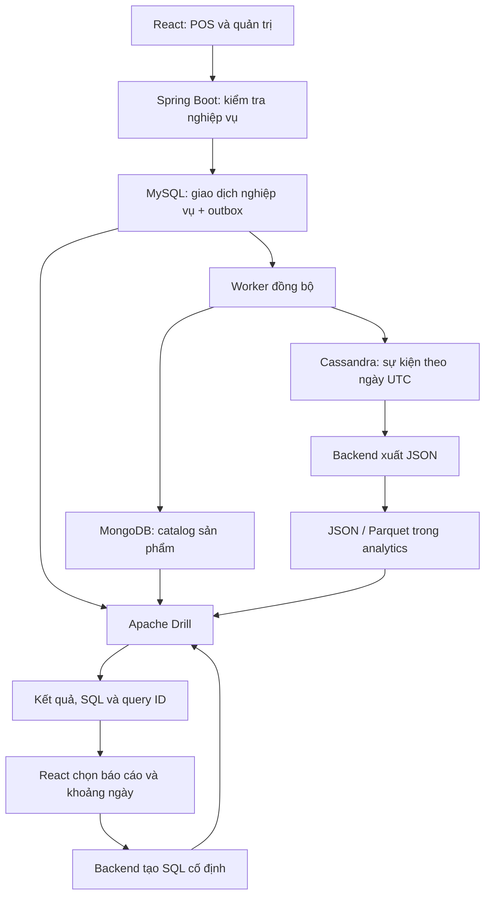

# TỔNG HỢP ĐỀ TÀI ĐỂ GỬI CHATGPT VIẾT BÁO CÁO WORD

Ngày tổng hợp: 30/10/2026. File này chứa bối cảnh và số liệu đã có để viết báo cáo, không phải bản tuyên bố hệ thống đã hoàn thiện mọi kiểm thử.

## 1. Prompt có thể gửi trực tiếp cùng file này

> Hãy viết báo cáo học phần Nhập môn Big Data bằng tiếng Việt với đề tài **“Phân tích dữ liệu vận hành siêu thị đa nguồn bằng Apache Drill”**, dựa trên toàn bộ thông tin trong tài liệu đính kèm này. Tôi có thể gửi thêm file Word mẫu, biểu đồ PNG, ảnh Drill Profile và CSV số liệu.
>
> Hãy viết theo văn phong báo cáo sinh viên: rõ ràng, có giải thích tại sao chọn cách làm, luồng dữ liệu và ý nghĩa kết quả. Không chỉ kể tên công nghệ. Trình bày thành các chương, có bảng, sơ đồ, chú thích hình và tài liệu tham khảo. Ưu tiên Apache Drill và phân tích đa nguồn; phần POS là nguồn phát sinh dữ liệu, không lấn át trọng tâm đề tài.
>
> Phân biệt ba phạm vi: (1) trạng thái vận hành hiện tại 5.000 hóa đơn; (2) các snapshot và phép đo lịch sử 1k/3k/5k/7k; (3) đề xuất chưa thực hiện. Không cộng bản sao MongoDB/Cassandra vào số hóa đơn. Không nói bộ dữ liệu đang dùng lấy từ Kaggle/dunnhumby vì dữ liệu hiện tại do nhóm tạo bằng script.
>
> Giữ nguyên số đo thực tế, tỷ lệ thành công/thất bại, giới hạn bộ nhớ và lưu ý về cache/JVM. Không biến lượt lỗi thành 0 ms, không bỏ các lỗi OOM, không kết luận 7.000 hóa đơn là giới hạn của Drill. Không trộn lượt kiểm tra sau restart với trung vị warm-run. Nếu thiếu thông tin, dùng nhãn [CẦN BỔ SUNG], không bịa tên nhóm, MSSV, giảng viên, thời gian chạy, ảnh hay kết quả PASS.
>
> Có thể dùng bố cục 6 chương đề xuất bên dưới. Nếu tạo được DOCX, hãy tạo file Word có mục lục tự động, bảng và ảnh; nếu không, hãy cung cấp nội dung hoàn chỉnh để dán vào Word. Không tự đưa nội dung Hadoop/MapReduce/WordCount từ file mẫu thành phần đã triển khai trong đề tài này.

**Cách gửi cho ChatGPT:** upload file MD này và file Word mẫu. Muốn chèn đúng ảnh, phải upload thêm các ảnh được liệt kê ở cuối file; ChatGPT ở phiên khác không tự mở được đường dẫn ổ đĩa trên máy tôi. File HTML xem thử có thể upload hoặc mở để tham khảo, nhưng ảnh Word nên lấy từ PNG gốc.

## 2. Thông tin hành chính

| Thông tin | Giá trị |
|---|---|
| Tên đề tài | Phân tích dữ liệu vận hành siêu thị đa nguồn bằng Apache Drill |
| Học phần | Nhập môn Big Data |
| Trường/khoa trên Word mẫu | Trường Đại học Công Thương TP. HCM; Khoa Công nghệ thông tin — cần người dùng xác nhận |
| Tên nhóm, lớp, MSSV, giảng viên | [CẦN BỔ SUNG] |
| Nhóm 06 trong tên file mẫu | Thông tin của mẫu, chưa xác nhận là nhóm hiện tại |
| Mốc dữ liệu phân tích | 30 ngày Việt Nam: 30/09–29/10/2026 |
| Ngày cập nhật trạng thái hệ thống | 30/10/2026 |

File mẫu: `docs/word/BigData_ApacheMapreduce_Nhom6.docx`. Mẫu có nội dung Hadoop/MapReduce, WordCount và hình HDFS; chỉ kế thừa hình thức trình bày khi phù hợp. Không kế thừa kết quả, danh tính hoặc hình minh chứng của bài cũ.

## 3. Bài toán, mục tiêu và phạm vi

Hệ thống siêu thị phát sinh dữ liệu sản phẩm, lô nhập, hóa đơn POS, các món đã bán, phiếu trả và khoản thu/hoàn tiền. Việc vận hành cần dữ liệu nhất quán, nhưng mục đích phân tích cần nối dữ liệu từ nhiều nơi và giải thích vì sao số liệu khớp hoặc lệch.

Đề tài dùng MySQL làm nguồn giao dịch gốc, MongoDB làm catalog sản phẩm, Cassandra lưu sự kiện nghiệp vụ và Apache Drill thực hiện SQL phân tích trên các nguồn. Frontend hiển thị kết quả và cung cấp SQL/query ID để truy ngược cách tính. Mục tiêu chính là minh họa lưu trữ, đồng bộ, truy vấn đa nguồn, đối soát và trực quan hóa.

Phạm vi nghiệp vụ hiện tại:

- Bán trực tiếp tại quầy POS; có tiền mặt và chuyển khoản thủ công.
- Sản phẩm, giá bán, ảnh, trạng thái đang bán/ngừng bán.
- Nhà cung cấp có người liên hệ, điện thoại, địa chỉ; ngừng hợp tác thay vì xóa lịch sử.
- Nhập kho theo lô; FEFO ưu tiên lô còn hạn có hạn sử dụng gần nhất.
- Trả từng món/số lượng của hóa đơn, nhận hàng bán lại hoặc hàng hỏng; xác nhận hoàn tiền theo phiếu trả.
- Quản lý nhân viên/phân quyền; danh sách nhân viên không đưa khách hàng vào.
- Bán chạy, tồn/hạn dùng, gợi ý nhập, ABC, ngày/giờ và hình thức thanh toán, chất lượng dữ liệu, dòng tiền và đối soát.

Đã gỡ shop online, giỏ hàng online và quy trình giao hàng. Không đưa COD, vận chuyển, khách xác nhận nhận hàng, tích điểm hoặc khuyến mãi vào nội dung như chức năng đang triển khai. Không có bảng khách hàng riêng; tên/số điện thoại là thông tin tùy chọn trên hóa đơn POS. Không dùng refresh token và Liquibase trong phiên bản hiện tại. Không dùng Redis/Neo4j trong kiến trúc hiện tại.

## 4. Kiến trúc và vai trò từng thành phần

| Thành phần | Trách nhiệm và dữ liệu |
|---|---|
| React | Giao diện POS, quản trị, kho và báo cáo; không tự thay Drill để tính số liệu tổng hợp từ một trang danh sách |
| Spring Boot | API, kiểm tra nghiệp vụ, giao dịch MySQL, ghi outbox, gửi SQL cố định cho Drill, xuất sự kiện |
| MySQL `supermarket_api` | Nguồn gốc của sản phẩm, lô, hóa đơn, phiếu trả, khoản thu/hoàn và hàng đợi đồng bộ |
| MongoDB `supermarket_catalog.products_catalog` | Catalog với SKU, tên, nhóm, ảnh, thuộc tính linh hoạt, snapshot lô; phục vụ JOIN với dữ liệu bán hàng |
| Cassandra `supermarket_analytics.business_events_by_day` | Lịch sử sự kiện chia theo ngày UTC; có mã sự kiện ổn định |
| Apache Drill | Đọc MySQL qua JDBC, MongoDB qua storage plugin và file JSON/Parquet qua filesystem; JOIN, GROUP BY, tổng hợp và đối soát |
| JSON/Parquet | Bản xuất/chuẩn hóa sự kiện để Drill đọc; khác với database giao dịch |

**Điểm quan trọng:** Cassandra trong project **không được Drill truy vấn trực tiếp**. Backend đọc Cassandra, xuất JSON theo partition ngày UTC, rồi Drill đọc file. Pipeline chuyển sang Parquet đã có script; benchmark bên dưới dùng SQL đọc JSON, chưa phải benchmark so sánh JSON–Parquet.



Sơ đồ là mô tả luồng thiết kế. Khi đưa vào Word, dựng lại thành hình rõ chữ hoặc dùng công cụ hỗ trợ Mermaid; không coi nguyên khối mã Mermaid là ảnh đã render.

### Công nghệ và tổ chức source

- Backend: Java 21, Spring Boot 4.1.1, Spring Data JPA, MongoDB driver/Spring Data, Cassandra Java driver.
- Frontend: React 19, TypeScript, Vite 8, Tailwind CSS; màu giao diện chủ đạo xanh dương lạnh.
- Drill: 1.21.2, Docker local; Cassandra: Docker 4.1. MySQL/MongoDB đang dùng bản local.
- `frontend/`: source giao diện; `backend/`: Maven wrapper, pom.xml và source Spring Boot.
- `SQL/`: schema; `database/`: script nạp/xuất/điều chỉnh dữ liệu; `drill/`: plugin, Parquet và công cụ ảnh; `analytics/`: file cho Drill; `docs/`: tài liệu.
- Các địa chỉ môi trường local: frontend `localhost:3000`, backend `localhost:8080`, Drill Web Console `localhost:8048`. Cổng Drill container là 8047, được ánh xạ ra 8048 ở môi trường hiện tại.
- `.env` chứa cấu hình local, không đưa token, mật khẩu hoặc URI có thông tin đăng nhập vào báo cáo.

## 5. Nghiệp vụ cần giải thích trong báo cáo

### 5.1. Bán tại POS

Thu ngân chọn/quét sản phẩm, nhập số lượng, chọn tiền mặt/chuyển khoản và xác nhận. Backend kiểm tra quyền, trạng thái sản phẩm và tồn khả dụng. Khi đủ điều kiện, ghi hóa đơn, các dòng hàng, giá tại thời điểm bán, phân bổ lô, biến động xuất kho, biên nhận thanh toán và outbox. Các thao tác này phải nhất quán trong giao dịch.

Không bán khi sản phẩm ngừng kinh doanh hoặc không đủ tồn khả dụng. Sản phẩm tồn 0 vẫn có thể xuất hiện trong danh mục/quản trị và báo cáo hết hàng; không tự ẩn chỉ vì hết tồn.

### 5.2. Sản phẩm, lô và FEFO

Một SKU là một loại sản phẩm; mỗi lần nhập có thể tạo lô khác với ngày nhập, giá nhập, nhà cung cấp và hạn dùng khác. FEFO chọn lô còn bán được có hạn gần nhất. Đồ gia dụng có thể không có hạn dùng.

Hàng bán được cần có trạng thái lô ACTIVE và còn hạn. Phần hỏng được theo dõi riêng, không tăng tồn bán được. Khi bán, dòng hóa đơn lưu phân bổ theo batchId để truy ngược xuất lô nào và trả vào đâu.

Tồn sản phẩm phải đối chiếu với tổng còn lại của các lô. Tổng còn lại và tồn khả dụng không luôn giống nhau do trạng thái/hạn dùng. Giao diện kho gom theo sản phẩm, mở ra xem các lô; không có nghĩa gộp mất thông tin lô trong database.

### 5.3. Trả hàng và hoàn tiền

Nhân viên tra hóa đơn, chọn món và số lượng khách thực sự trả. Tổng đã trả không vượt tổng đã mua. Với món xuất từ nhiều lô, cần xác định lô phù hợp khi trả một phần. Giá hoàn dùng giá trên dòng hóa đơn, không dùng giá catalog hiện tại.

Hàng nguyên vẹn, đủ điều kiện có thể nhập lại lô gốc; hàng hỏng không được cộng vào tồn bán được. Phiếu trả ghi số tiền phải hoàn và có thể chờ nhân viên xác nhận chi trả. Chỉ khoản hoàn đã xác nhận mới được tính vào tiền đã hoàn của báo cáo dòng tiền.

### 5.4. Phân quyền

ADMIN quản trị; STAFF bán POS và xử lý theo quyền; WAREHOUSE nhập/điều chỉnh kho. Mã MANAGER còn được hỗ trợ ở một số kiểm tra quyền nhưng không được suy ra rằng đã có tài khoản quản lý trong bộ mẫu. Tài khoản ADMIN không được đưa nút bán POS trong giao diện theo phạm vi đã chốt.

## 6. Lưu trữ MySQL và NoSQL

MySQL hiện có **11 bảng**, schema chuẩn nằm ở `SQL/schema.sql`:

| Bảng | Vai trò |
|---|---|
| roles | Vai trò/phân quyền |
| users | Tài khoản nhân viên |
| suppliers | Nhà cung cấp và thông tin liên hệ |
| products | SKU, tên, nhóm, giá, trạng thái và số tồn tổng hợp |
| inventory_batches | Lô nhập, số lượng còn/hỏng, giá nhập, hạn dùng, nhà cung cấp |
| stock_movements | Lịch sử nhập/xuất/nhận trả/điều chỉnh |
| sales_orders | Hóa đơn POS, thời gian, phương thức, trạng thái và thông tin khách tùy chọn |
| sales_order_items | Dòng hàng, số lượng, giá bán, số đã trả; JSON phân bổ lô |
| sales_order_returns | Phiếu trả, tiền phải hoàn, trạng thái; JSON các món nhận trả |
| payment_records | Khoản thu/hoàn đã xác nhận, tham chiếu hóa đơn/phiếu trả |
| data_sync_outbox | Payload và trạng thái gửi đồng bộ |

Không có bảng category riêng; nhóm lưu tại `products.category_name`. Không có bảng allocation/return-item riêng trong mô hình rút gọn hiện tại; dữ liệu tương ứng nằm trong JSON của hai bảng kể trên. `version` của sản phẩm hỗ trợ kiểm soát cập nhật đồng thời, không phải số phiên bản catalog để người dùng tự tăng.

### MongoDB

Collection catalog liên kết với MySQL bằng SKU; productId giúp ánh xạ ID nội bộ. Document chứa tên, nhóm, ảnh, giá và snapshot lô. Thuộc tính như dung tích, khối lượng, vật liệu có thể lưu trong `attributes`. Không khẳng định mọi document hiện có đều đã được điền đầy đủ thuộc tính/ảnh.

Catalog là bản chiếu phục vụ đọc; nó không thay MySQL quyết định tồn được phép bán. Projector cập nhật một phần document để giữ các thuộc tính MongoDB bổ sung.

### Cassandra

Khóa chính của bảng sự kiện là `((event_date), event_time, event_id)`; partition theo ngày UTC. Các trường chính: event_type, order_id, product_sku, quantity, amount, payment_method, status và metadata.

Ví dụ sự kiện: INVENTORY_RECEIVED, INVENTORY_SOLD, INVENTORY_RETURNED, INVENTORY_QUARANTINED, PAYMENT_RECEIVED, REFUND_CONFIRMED và các chuyển trạng thái đơn được code ghi nhận. Không tự thêm các sự kiện online vào báo cáo hiện tại.

event_id được tạo ổn định từ khóa sự kiện nguồn. Vẫn phải giữ thời gian/partition đúng: cùng event_id nhưng thời gian khác có thể thành khóa Cassandra khác; các script điều chỉnh ngày đã xử lý khóa cũ và mới để tránh lưu hai bản.

## 7. Đồng bộ, xuất dữ liệu và vai trò Drill

1. API nghiệp vụ ghi MySQL và outbox trong cùng giao dịch.
2. Worker đọc outbox, gửi tới MongoDB/Cassandra, ghi trạng thái SENT hoặc lên lịch thử lại khi lỗi.
3. Catalog MongoDB phục vụ JOIN; Cassandra giữ sự kiện. Hàng đợi về 0 chỉ nói các yêu cầu đã gửi, không chứng minh mọi phép đối soát đều PASS.
4. Backend xuất Cassandra theo ngày UTC thành JSON trong `analytics/cassandra/`. Một ngày Việt Nam có thể cần file của cả ngày UTC trước và ngày UTC đang chọn.
5. Pipeline có thể tạo Parquet; nếu bản chuẩn hóa không còn khớp JSON mới, không được mặc nhiên dùng số liệu cũ. Các script liên quan ở `drill/curate-events-parquet.ps1` và `drill/curate-all-events-parquet.ps1`.
6. Backend tạo SQL theo loại báo cáo/đầu vào đã kiểm tra, gửi Drill qua REST. Drill đọc nguồn, JOIN/tổng hợp và trả rows, query ID.
7. Frontend hiển thị kết quả cùng mô tả nguồn/SQL để người dùng hiểu và truy vết Profile khi lỗi.

**Lưu ý:** số yêu cầu outbox đã gửi không phải số sản phẩm. Một SKU có thể sinh nhiều yêu cầu đồng bộ khi nhập, bán, trả hoặc đổi thông tin.

## 8. Các báo cáo và định nghĩa chỉ tiêu

| Báo cáo | Nguồn và ý nghĩa |
|---|---|
| SALES — Bán chạy | MySQL dòng hàng/hóa đơn JOIN catalog MongoDB; xếp theo số lượng bán ròng giảm dần |
| ABC | Phân nhóm theo giá trị tiền hàng ròng tích lũy; logic trong source dùng các ngưỡng 80%/95% |
| EXPIRY | Lô ACTIVE còn tồn có hạn trong 7/14/30 ngày; kho là ảnh chụp hiện tại |
| REPLENISHMENT | Gợi ý theo bán ròng 30 ngày đến ngày kết thúc, tồn hiện tại và tham số leadDays/coverageDays; không phải dự báo ML |
| CHANNELS | Thống kê theo ngày/giờ Việt Nam và hình thức thanh toán. Tên enum cũ còn là CHANNELS nhưng phạm vi hiện tại chỉ POS, không so sánh shop online |
| QUALITY | SKU thiếu/trùng giữa MySQL–MongoDB, số tồn lô không hợp lệ và lượng trả vượt mua |
| CASH_FLOW | Tiền thu/hoàn từ bản xuất Cassandra; bảng theo ngày Việt Nam |
| RECONCILIATION | So MySQL với sự kiện Cassandra đã xuất, đồng thời so tổng tiền món với tiền hàng trên đơn |

Các công thức cần dùng đúng:

```text
SL bán ròng = SL bán trên dòng hóa đơn − SL đã nhận trả
Tiền hàng sau khi trừ hàng trả = Σ(SL bán ròng × đơn giá tại lúc bán)
Tỷ trọng số lượng SKU = SL bán ròng SKU / tổng SL bán ròng các SKU × 100%
Tiền thu ròng = tổng khoản thu đã xác nhận − tổng khoản hoàn đã xác nhận
Chênh lệch thu = tiền thu MySQL − tiền thu trong sự kiện Cassandra đã đọc
Chênh lệch hoàn = tiền hoàn MySQL − tiền hoàn trong sự kiện Cassandra đã đọc
Giá trị hàng sắp hết hạn theo giá nhập = số lượng còn lại × unit_cost
```

“Tiền hàng sau khi trừ hàng trả” là tên giao diện đã thống nhất, thay tên khó hiểu “Giá trị món sau trả”. Nó không đồng nghĩa tiền thu ròng, lợi nhuận hoặc khoản hoàn đã chi.

Ví dụ: bán 10 chai × 5.000 đồng, nhận trả 2 chai thì tiền hàng sau trả là 40.000 đồng. Nếu khoản hoàn 10.000 đồng vẫn chờ xác nhận, dòng tiền chưa ghi nhận chi khoản đó.

**Giới hạn thời gian của bán ròng:** SQL lọc hóa đơn theo ngày tạo, rồi trừ returned_quantity đã ghi nhận đến lúc truy vấn. Do đó không nên gọi đây là sổ diễn biến trả hàng theo từng ngày hoặc doanh thu lịch sử bất biến. Dòng tiền thì theo thời điểm biên nhận thu/hoàn.

Kho/hạn dùng là ảnh chụp hiện tại. Giá trị hàng cần theo dõi không đồng nghĩa hàng đã hỏng hoặc tiền đã thất thoát.

### Đối soát

So sánh số lượt thu/hoàn và số tiền giữa MySQL–Cassandra theo ngày Việt Nam. So sánh thêm `sales_orders.subtotal` với tổng `sales_order_items.subtotal`. Trạng thái PASS cần có bản xuất thích hợp, số đếm khớp và chênh tiền trong ngưỡng 0,01; nếu không thì CHECK. PASS chỉ áp dụng các phép đối chiếu đã chạy và dữ liệu đã đọc, không chứng minh toàn bộ hệ thống đã đúng.

## 9. Ngày Việt Nam và dữ liệu mẫu

Người dùng xem ngày/giờ Việt Nam UTC+7. Các timestamp/phân vùng sự kiện được quản lý theo UTC bên trong; backend đổi ranh giới để lọc đúng ngày. Ví dụ 00:00 ngày 01/10 Việt Nam tương ứng 17:00 UTC ngày 30/09. Không tự cộng thêm 7 giờ một lần nữa lên giá trị đã chuyển để tránh lệch ngày.

Dữ liệu hiện dùng do nhóm tạo bằng script qua API nghiệp vụ. Các trường hợp hoàn tiền và lô nhập được liên kết bằng ID thật trong database. Sau khi tạo, thời gian của bộ mẫu được trải trên 30 ngày theo thứ tự gốc, cùng cập nhật MySQL, outbox và khóa sự kiện Cassandra. Đây là dữ liệu học tập, không phải giao dịch thu thập từ một siêu thị thật.

Nguồn dunnhumby đã được tải/khảo sát để đánh giá tính phù hợp nhưng **chưa nhập vào hệ thống**. Không ghi rằng dữ liệu hiện tại lấy từ Kaggle/UCI/dunnhumby. Báo cáo khảo sát nằm ở `docs/ai/KHAO_SAT_NGUON_DUNNHUMBY.md`.

## 10. Dữ liệu hiện tại và các mốc lịch sử

Trạng thái hiện tại sau ngày 30/10/2026: đã gỡ đợt 2.000 hóa đơn `POS-ORDERS-7000`, khôi phục tồn và lịch sử snapshot 5k. Các ảnh/Profile/Word 7k vẫn giữ làm bằng chứng lịch sử.

Các số lượng snapshot hiện tại và bảng benchmark được chèn nguyên dữ liệu ở phần cuối tài liệu này. Chúng là số đếm đã kiểm tra, không phải quy mô dự kiến.

Phải phân biệt:

- **5.000 hóa đơn hiện tại** không phải 5.000 khách hàng có tài khoản riêng.
- Một hóa đơn chứa nhiều dòng hàng, một dòng hàng có thể chứa nhiều đơn vị sản phẩm.
- Tổng bản ghi nghiệp vụ MySQL cộng các bảng một lần, không cộng thêm catalog/sự kiện sao chép để phóng đại dữ liệu gốc.
- `data_sync_outbox`, roles và users không được đưa vào tổng bản ghi nghiệp vụ được báo cáo trong manifest.
- Dữ liệu vận hành hiện tại 5k khác với snapshot 1k được dùng tạo bộ biểu đồ nghiệp vụ đầu tiên và các snapshot đo 3k/7k.

## 11. Phương pháp benchmark đã thực hiện

Mục đích: quan sát cùng luồng SQL khi tăng tổng hóa đơn POS từ 1.000 lên 3.000, 5.000 và 7.000 trên máy local.

- SALES: Top 20 bán chạy, đọc MySQL + MongoDB.
- CASH_FLOW: tiền theo 30 ngày, đọc bản xuất Cassandra JSON. Không phải phép đo native CQL trong Cassandra.
- Cùng SQL, khoảng ngày Việt Nam 30/09–29/10/2026, cùng cấu hình Drill. Các script dựng báo cáo so sánh SQL/config trước khi xuất.
- Mỗi loại báo cáo có một lượt warm-up và ba lượt đo tuần tự. Có gọi API trước ở các lượt đầu để lấy SQL; không coi đây là phép đo cold-cache có kiểm soát.
- Không xóa cache, không restart Drill giữa các mốc đo chính. Backend có tạm dừng/bật lại khi phân bố lịch sử; đây không phải restart Drill.
- Chờ hàng đợi đồng bộ hết và xuất đủ ngày trước khi đo. Không chạy bộ unit/integration test để suy ra số benchmark này.
- Có 32 Profile gốc (4 mốc × 2 báo cáo × 4 lượt), 19 ảnh Profile gồm tóm tắt/toàn trang và các ảnh lỗi.
- Ảnh đại diện thành công lấy từ lượt có thời gian gần trung vị, không chọn tùy ý lượt nhanh nhất. Khi không có lượt thành công thì ảnh minh chứng là lượt lỗi.

### Ý nghĩa chỉ số

| Chỉ số | Ý nghĩa |
|---|---|
| profileTotalMs | Profile.end − Profile.start |
| planningMs | Profile.planEnd − Profile.start |
| executionAfterQueueMs | end − max(queueWaitEnd, planEnd) |
| httpElapsedMs | Client chờ HTTP Drill; không đồng nhất thời gian nội bộ Profile |
| maxFragmentPeakBytes | max(maxMemoryUsed) giữa các minor fragment; không phải tổng/đỉnh RAM container |
| totalFragments | Số fragment trong Profile, không phải số máy |
| rows | Số dòng kết quả: Top 20 trả 20 dòng, không nghĩa chỉ quét 20 dòng nguồn |
| Total Cost trên Web Profile | Ước lượng của optimizer, không phải tiền và không phải số thời gian đã đo |

Trung vị các thành phần được tính riêng, không nhất thiết cộng đúng bằng trung vị tổng. Khi có lỗi, thống kê chỉ dựa các lượt thành công và luôn ghi tỷ lệ đạt. Mốc chỉ thành công 1/3 lượt không có độ tin cậy tương đương mốc đạt 3/3. Không thay lỗi bằng 0 ms.

### Lỗi bộ nhớ và cách diễn giải

Drill từng báo OutOfMemoryException khi direct memory chạm 1.073.741.824 byte (1 GiB). Cấu hình local được giảm song song và số partition của hash JOIN. Những lỗi OOM xuất hiện trong benchmark 5k/7k vẫn được giữ lại.

Sau khi hoàn thành chuỗi đo, có restart Drill và kiểm tra riêng ở 7k. Hai truy vấn lại thành công. Điều này cho thấy không thể kết luận “7.000 hóa đơn là giới hạn của Drill”; trạng thái bộ nhớ tích lũy, buffer, cache và JVM có thể ảnh hưởng. Kết quả kiểm tra khôi phục là một lượt riêng, không trộn vào trung vị warm-run hoặc vẽ thay điểm lỗi.

Đây là minh họa local với ba lượt đo, chưa đủ suy ra p95 đáng tin cậy, hiệu năng sản xuất, xử lý GB/TB, khả năng scale nhiều node hoặc nhiều người dùng đồng thời. Kết quả mốc lớn có thể nhanh hơn mốc nhỏ; giữ nguyên số thật và giải thích giới hạn thay vì ép đường tăng tuyến tính.

## 12. Biểu đồ, ảnh và Word hiện có

### Bộ biểu đồ nghiệp vụ đầu tiên — snapshot 1k

Trong `docs/word/bao_cao_du_lieu/`:

- `ban-chay.png`: Top 10 theo số lượng bán ròng.
- `dong-tien.png`: tiền thu ròng 30 ngày.
- `sap-het-han.png`: 5 lô sắp hết hạn tại thời điểm truy vấn cũ.
- `bang-1.csv`, `bang-2.csv`, `bang-3.csv`: bảng số liệu tương ứng.
- `sales.json`, `cash.json`, `expiry.json`: kết quả từ API/Drill có query ID.
- `bao_cao_bang_bieu.html`: bản xem biểu đồ và mở bảng.

**Không gọi các biểu đồ trên là kết quả hiện tại 5k.** Ví dụ số thu ròng 137.458.500 đồng và số hoàn 377.000 đồng thuộc snapshot 1k, không được đặt dưới tiêu đề bộ 5k/7k. Nếu muốn số liệu vận hành 5k, cần chạy/xuất báo cáo mới.

### Bộ benchmark lịch sử

Trong `docs/benchmark/`:

- `sales-time.png`: so sánh thời gian bán chạy; mốc không có lượt thành công được ghi lỗi, không vẽ cột 0 ms.
- `cash-time.png`: thời gian của lượt thành công, phải xem cùng tỷ lệ đạt.
- `fragment-memory.png`: bộ nhớ fragment, không phải RAM toàn tiến trình.
- `comparison.csv`: bảng tổng hợp chính xác.
- `environment.json`: cấu hình máy và container.
- `benchmark.html`: bản xem thử có ảnh, bảng và liên kết Profile.
- `1000/`, `3000/`, `5000/`, `7000/`: SQL, kết quả đo, Profile JSON và ảnh chụp.
- `7000/recovery-after-restart/`: kết quả kiểm tra sau restart, tách khỏi bảng chính.
- `PHUONG_PHAP_DO.md`: phương pháp và giới hạn.

### File Word

| File trong docs/word | Nội dung |
|---|---|
| BigData_ApacheMapreduce_Nhom6.docx | Mẫu cũ, không sửa file gốc |
| BigData_ApacheDrill_Nhom6_BanThietKe.docx | Bản nháp 6 chương, khoảng 2.946 từ, 10 bảng; thông tin còn chỗ cần xác nhận |
| BigData_ApacheDrill_Nhom6_CoBieuDo.docx | Bản nháp có thêm biểu đồ nghiệp vụ snapshot 1k |
| BigData_ApacheDrill_Nhom6_Benchmark.docx | Có thêm phụ lục benchmark, biểu đồ so sánh và ảnh Profile; bối cảnh ghi tại thời điểm thử đến 7k |

Bản Word chưa được kiểm tra dàn trang trực quan toàn bộ trong Microsoft Word. Cần cập nhật mục lục bằng Ctrl+A → F9, kiểm tra ngắt trang/bảng/ảnh và thay thông tin placeholder trước khi nộp. Không nói file đã là bản báo cáo học thuật hoàn chỉnh được duyệt.

## 13. Cấu trúc báo cáo Word đề xuất

| Phần | Nội dung trọng tâm |
|---|---|
| Bìa, mục lục, danh mục hình/bảng, từ viết tắt | Thông tin được xác nhận; không dùng mục lục MapReduce cũ |
| Chương 1: Giới thiệu | Bài toán vận hành siêu thị, nhu cầu phân tích đa nguồn, mục tiêu và phạm vi |
| Chương 2: Cơ sở lý thuyết | Drill, storage plugin, dữ liệu cấu trúc/bán cấu trúc, MySQL/MongoDB/Cassandra, JSON/Parquet, outbox |
| Chương 3: Phân tích và thiết kế | Vai trò từng nguồn, khóa liên kết, schema 11 bảng, luồng giao dịch/đồng bộ/SQL, FEFO và trả hàng |
| Chương 4: Triển khai | Môi trường local, cấu trúc source, tạo dữ liệu, script ba nguồn, báo cáo và SQL minh họa |
| Chương 5: Kết quả và đánh giá | Bảng/biểu đồ có đúng snapshot; benchmark 4 mốc, Profile, lỗi OOM, khôi phục và giới hạn kết luận |
| Chương 6: Kết luận và hướng phát triển | Điều đã làm, hạn chế, tối ưu query/bộ nhớ, thử nghiệm độc lập và JSON–Parquet còn cần đo |
| Tài liệu tham khảo, phụ lục | Nguồn chính thức, SQL, phương pháp benchmark, ảnh Profile, bộ nạp |

Không biến báo cáo thành danh sách API dài. Mỗi nhóm chức năng nên giải thích bối cảnh → dữ liệu → luồng xử lý → kết quả và giới hạn. Đặt bảng cạnh biểu đồ, ghi đơn vị và khoảng thời gian, có đoạn nhận xét dựa trên số liệu thật.

## 14. Rubric đã được người dùng cung cấp

| Tiêu chí | Trọng số |
|---|---:|
| Tính ứng dụng của kỹ thuật | 10% |
| Lưu trữ, xử lý và phân tích dữ liệu | 20% |
| Mô hình/công nghệ xử lý bài toán | 25% |
| Trực quan hóa/xây dựng ứng dụng | 25% |
| Trình bày báo cáo | 10% |
| Phân công và phối hợp nhóm | 10% |

Để hỗ trợ rubric, nhấn mạnh lý do chọn mô hình đa nguồn, luồng dữ liệu có thể giải thích, SQL/profile thật, bảng/biểu đồ và khả năng truy vết chênh lệch. Chưa có thông tin phân công thực tế của nhóm, không tự điền tên hoặc tự nhận xét đạt điểm tối đa. Rubric đã gửi không ghi bắt buộc dữ liệu Kaggle, nhưng chưa có toàn bộ đề bài/yêu cầu riêng của giảng viên.

## 15. Các API và script để tham chiếu

| API | Vai trò |
|---|---|
| GET /api/analytics/operational | Báo cáo SALES/ABC/EXPIRY/REPLENISHMENT/CHANNELS/QUALITY |
| GET /api/analytics/dashboard | Tổng quan qua Drill |
| GET /api/analytics/inventory | Phân tích tồn kho |
| GET /api/analytics/cash-flow | Thu, hoàn và thu ròng theo ngày |
| GET /api/analytics/reconciliation | Đối soát MySQL–Cassandra và tổng đơn/món |
| GET /api/integrations/status | Kết nối và hàng đợi; không thay thế kiểm tra truy vấn thực tế |
| POST /api/integrations/dispatch | Gửi nhóm yêu cầu outbox |
| POST /api/integrations/astra/events/export | Xuất sự kiện; tên API còn astra nhưng chế độ hiện tại là Cassandra local |

Các báo cáo ngày nhận from/to. Giao diện đã bỏ dropdown dữ liệu mô phỏng và cố định dữ liệu vận hành. Backend còn một số enum/path hỗ trợ SIMULATED cũ; không mô tả đó là bộ dữ liệu đang dùng trên giao diện.

| Script | Công dụng |
|---|---|
| database/seed-pos-operations.py | Tạo đợt đầu khoảng 1.001 bản ghi nghiệp vụ, mặc định xem kế hoạch; --apply mới ghi |
| database/extend-pos-orders.py | Mở rộng tổng hóa đơn tới mốc hỗ trợ; tạo dữ liệu qua API, nhập lô khi thiếu và đồng bộ |
| database/spread-pos-history.py | Điều chỉnh lịch sử mẫu theo thời gian đã chốt; cập nhật MySQL/outbox/Cassandra, có snapshot tiến độ |
| database/seed-mysql.sql | Snapshot nghiệp vụ hiện tại để nhập lại, giữ ID; không chạy trên database đã có các ID đó |
| database/seed-mongodb.js | Catalog tương ứng, chạy bằng mongosh |
| database/seed-cassandra.cql | Sự kiện tương ứng, giữ UUID và thời gian UTC |
| database/export-pos-snapshot.py | Xuất bộ seed từ nguồn hiện có; không ghi database |
| database/benchmark-drill.py | Đo SQL cố định, lưu cả thành công/lỗi và Profile |
| database/run-benchmark-stages.ps1 | Chuẩn bị/tăng dữ liệu, đồng bộ, phân bố lịch sử và đo từng mốc |
| drill/capture-benchmark.mjs | Chụp giao diện Drill Profile thật bằng trình duyệt headless |
| drill/render-benchmark.ps1 | Dựng PNG từ kết quả thật |
| docs/word/build_benchmark_report.py | Tạo CSV/HTML/Word benchmark từ các mốc đã đo |
| database/keep-5000-orders.py | Dọn riêng 2.000 hóa đơn mẫu đợt 7k, khôi phục tồn và snapshot 5k; đã thực hiện |

Ba file seed hiện tại chứa **5k**, trong khi mốc 7k chỉ còn trong bằng chứng benchmark/backup. Không ghi rằng script mặc nhiên an toàn để chạy đè lên dữ liệu thật; các bộ nạp/snapshot có điều kiện và phải dùng đúng hướng dẫn.

## 16. Tài liệu tham khảo chính thức

1. Apache Drill — Architecture Introduction: https://drill.apache.org/docs/architecture-introduction/
2. Apache Drill — Connect a Data Source Introduction: https://drill.apache.org/docs/connect-a-data-source-introduction/
3. Apache Drill — Performance: https://drill.apache.org/docs/performance/
4. Apache Drill — Parquet Format: https://drill.apache.org/docs/parquet-format/
5. Apache Drill — Configuring Drill Memory: https://drill.apache.org/docs/configuring-drill-memory/
6. Apache Drill — Configuration Options Introduction: https://drill.apache.org/docs/configuration-options-introduction/
7. Source nội bộ: SQL/schema.sql, backend/src/main/java/com/api/supermarket/integration/, database/seed-manifest.json, docs/benchmark/ và các script liệt kê phía trên.

Nguồn tham khảo không đồng nghĩa nguồn dữ liệu. Nếu nhắc nghiên cứu dunnhumby, phải ghi là nguồn đã khảo sát, không dùng để gắn nguồn gốc cho dữ liệu script hiện tại.

## 17. Điều chưa được chứng minh và thông tin cần bổ sung

- Chưa có kết quả unit/integration test toàn diện để khẳng định toàn bộ nghiệp vụ không có lỗi.
- Chưa kiểm tra trực quan toàn bộ dàn trang Word.
- Chưa có so sánh hiệu năng JSON–Parquet có kiểm soát; không tự điền tỷ lệ nén hoặc phần trăm tăng tốc.
- Chưa có đo nhiều node, tải đồng thời, dữ liệu GB/TB hoặc p95 đáng tin cậy.
- Chưa có một lượt đối soát xác nhận mọi ngày/mọi nguồn PASS sau mọi thao tác; không suy ra điều này từ hàng đợi bằng 0.
- Bảng benchmark là lịch sử thử nghiệm đã lưu; database hiện còn 5k sau khi dọn đợt 7k.
- Tên/MSSV/thành viên/phân công/giảng viên và yêu cầu riêng của thầy còn cần người dùng xác nhận.

Phần dưới được chèn tự động từ manifest, kết quả benchmark và danh sách ảnh đã lưu để giảm sai số khi chép số liệu.


## 18. Snapshot: 5.000 hóa đơn hiện tại

| MySQL table | Records |
|---|---:|
| `suppliers` | 8 |
| `products` | 56 |
| `inventory_batches` | 142 |
| `sales_orders` | 5,000 |
| `sales_order_items` | 12,496 |
| `sales_order_returns` | 12 |
| `payment_records` | 5,008 |
| `stock_movements` | 12,651 |
| Total of the eight tables above | 35,373 |

MongoDB: **56 documents**. Cassandra: **22,679 events**.

Phạm vi ngày Việt Nam: **2026-09-30 – 2026-10-29**, 30 ngày có hóa đơn. Tổng trên không bao gồm roles, users và outbox; không gọi là tổng của cả 11 bảng.

Nguồn: `database/seed-manifest.json`. Đây là snapshot đã lưu sau khi dọn dữ liệu; không phải lần truy vấn database mới trong lượt soạn tài liệu này.

## 19. Benchmark: bảng số đo đã lưu

| Hóa đơn | Dòng hàng | Báo cáo | Trung vị (ms) | Nhỏ nhất (ms) | Lớn nhất (ms) | Lập kế hoạch (ms) | Thực thi (ms) | Đỉnh fragment (MiB) |
| --- | --- | --- | --- | --- | --- | --- | --- | --- |
| 1000 | 2496 | Bán chạy (3/3 đạt) | 420 | 393 | 446 | 297 | 121 | 58.76 |
| 1000 | 2496 | Dòng tiền (3/3 đạt) | 6477 | 6220 | 6724 | 4716 | 1577 | 800.72 |
| 3000 | 7496 | Bán chạy (3/3 đạt) | 505 | 497 | 528 | 349 | 156 | 58.76 |
| 3000 | 7496 | Dòng tiền (3/3 đạt) | 5801 | 5754 | 6136 | 4308 | 1493 | 800.72 |
| 5000 | 12496 | Bán chạy (3/3 đạt) | 592 | 512 | 602 | 359 | 232 | 57.76 |
| 5000 | 12496 | Dòng tiền (1/3 đạt) | 5229 | 5229 | 5229 | 3834 | 1395 | 800.72 |
| 7000 | 17496 | Bán chạy (0/3 đạt) | Không đo được | Không đo được | Không đo được | Không đo được | Không đo được | Không đo được |
| 7000 | 17496 | Dòng tiền (1/3 đạt) | 7711 | 7711 | 7711 | 5375 | 2336 | 800.72 |

Nguồn: `docs/benchmark/comparison.csv`. Trung vị chỉ tính trên lượt thành công; 1/3 không tương đương 3/3. Không điền 0 cho lượt lỗi. Đỉnh fragment không phải RAM toàn tiến trình.

### Query ID đối chiếu với Profiles

| Orders | Report | Representative query ID | Measured success | Failed measured query IDs |
|---:|---|---|---|---|
| 1000 | SALES | `151c924d-a343-4959-af75-09c4e5b8df88` | 3/3 | — |
| 1000 | CASH_FLOW | `151c9234-4dd9-1f1d-faf9-8f6db5cca56d` | 3/3 | — |
| 3000 | SALES | `151c9027-4f44-c001-7432-702620cf1b2f` | 3/3 | — |
| 3000 | CASH_FLOW | `151c9019-3c0f-e86a-efa8-08a579cbe186` | 3/3 | — |
| 5000 | SALES | `151c8eb6-081d-5ea5-fd97-b64ddbec1178` | 3/3 | — |
| 5000 | CASH_FLOW | `151c8ea7-f200-573f-98b0-98804d8e0828` | 1/3 | `151c8ea3-28a0-2c57-0c5b-c250dfa0faff`; `151c8dff-114c-90fc-1396-006ad5a4c2b6` |
| 7000 | SALES | `151c8c42-4c4e-1a33-10a2-0ff1c51a2401` | 0/3 | `151c8c42-4c4e-1a33-10a2-0ff1c51a2401`; `151c8c41-54a6-554b-8f95-67a2014e0dca`; `151c8c40-ec1a-f43b-c806-dfec5c36eba4` |
| 7000 | CASH_FLOW | `151c8c31-2e6b-2fd4-f1f8-3e3d6c218cb6` | 1/3 | `151c8c3a-d951-c605-92af-883d83bc99aa`; `151c8c36-035e-19d0-c03f-7fb2a221003a` |

### Kiểm tra phục hồi sau khi restart Drill (7k lịch sử)

| Report | State | Total ms | Rows | Query ID |
|---|---|---:|---:|---|
| SALES | COMPLETED | 5784 | 20 | `151c8b79-4981-cf1b-9077-5ff2a30054ba` |
| CASH_FLOW | COMPLETED | 8949 | 30 | `151c8b72-c44b-e9c0-48ee-7140c187dd6c` |

Hai phép kiểm tra riêng lẻ này không gộp vào trung vị benchmark. Không kết luận 7k là giới hạn dung lượng của Drill.

### Môi trường đo

```json
{
  "cpu": "13th Gen Intel(R) Core(TM) i5-13420H",
  "logicalProcessors": 12,
  "hostRamGiB": 15.71,
  "drillContainerMemoryBytes": 3221225472,
  "drillMemorySettings": [
    "DRILL_MAX_DIRECT_MEMORY=1024M",
    "DRILL_HEAP=1024M"
  ],
  "note": "Local illustrative experiment; same SQL/date range, warm runs, no container restart between measured stages."
}
```

## 20. Danh sách ảnh đính kèm cho Word

Các đường dẫn dưới tính từ gốc repo. Phải upload file ảnh thật khi gửi ChatGPT, không chỉ gửi đường dẫn.

| Caption gợi ý | File | Phạm vi |
|---|---|---|
| Hình 5.1: Sản phẩm bán chạy theo số lượng ròng | `docs/word/bao_cao_du_lieu/ban-chay.png` | Snapshot 1k cũ |
| Hình 5.2: Dòng tiền theo ngày | `docs/word/bao_cao_du_lieu/dong-tien.png` | Snapshot 1k cũ |
| Hình 5.3: Hàng sắp hết hạn | `docs/word/bao_cao_du_lieu/sap-het-han.png` | Snapshot cũ ngày 29/10 |
| Hình 5.4: Thời gian báo cáo bán chạy | `docs/benchmark/sales-time.png` | Benchmark lịch sử |
| Hình 5.5: Thời gian báo cáo dòng tiền | `docs/benchmark/cash-time.png` | Benchmark lịch sử |
| Hình 5.6: Bộ nhớ đỉnh fragment | `docs/benchmark/fragment-memory.png` | Không phải RAM toàn Drill |

Ảnh Profiles chi tiết (ưu tiên bản summary cho Word; bản cuộn dài để phụ lục):

- `docs/benchmark/1000/CASH_FLOW-profile-summary.png`
- `docs/benchmark/1000/CASH_FLOW-profile.png`
- `docs/benchmark/1000/SALES-profile-summary.png`
- `docs/benchmark/1000/SALES-profile.png`
- `docs/benchmark/3000/CASH_FLOW-profile-summary.png`
- `docs/benchmark/3000/CASH_FLOW-profile.png`
- `docs/benchmark/3000/SALES-profile-summary.png`
- `docs/benchmark/3000/SALES-profile.png`
- `docs/benchmark/5000/CASH_FLOW-failed-profile-summary.png`
- `docs/benchmark/5000/CASH_FLOW-profile-summary.png`
- `docs/benchmark/5000/CASH_FLOW-profile.png`
- `docs/benchmark/5000/SALES-profile-summary.png`
- `docs/benchmark/5000/SALES-profile.png`
- `docs/benchmark/7000/CASH_FLOW-failed-profile-summary.png`
- `docs/benchmark/7000/CASH_FLOW-profile-summary.png`
- `docs/benchmark/7000/CASH_FLOW-profile.png`
- `docs/benchmark/7000/SALES-failed-profile-summary.png`
- `docs/benchmark/7000/SALES-profile-summary.png`
- `docs/benchmark/7000/SALES-profile.png`

## 21. SQL minh chứng đã dùng trong benchmark

Báo cáo SALES kết hợp MySQL và MongoDB. Đây là SQL đã lưu, không phải truy vấn mới được chạy trong lượt này.

```sql
WITH sale_lines AS (SELECT o.order_id, o.created_at, o.order_type, o.payment_method, i.product_id, i.unit_price, i.quantity - COALESCE(i.returned_quantity, 0) AS net_quantity FROM mysql_source.supermarket_api.sales_order_items i JOIN mysql_source.supermarket_api.sales_orders o ON o.order_id = i.order_id WHERE o.created_at >= TIMESTAMP '2026-09-29 17:00:00' AND o.created_at < TIMESTAMP '2026-10-29 17:00:00' AND o.order_type = 'IN_STORE' AND o.status IN ('PAID','PARTIALLY_RETURNED','RETURNED')), catalog AS (SELECT sku, MAX(name) AS name, MAX(categoryName) AS category_name, COUNT(*) AS catalog_count FROM mongo_source.supermarket_catalog.products_catalog GROUP BY sku), sales AS (SELECT p.product_id, p.sku_code AS sku, COALESCE(m.name, p.name) AS product_name, COALESCE(m.category_name, 'Chưa có catalog MongoDB') AS category_name, COALESCE(m.catalog_count, 0) AS catalog_count, SUM(l.net_quantity) AS net_quantity, SUM(l.net_quantity * l.unit_price) AS net_sales_amount FROM sale_lines l JOIN mysql_source.supermarket_api.products p ON p.product_id = l.product_id LEFT JOIN catalog m ON CAST(p.sku_code AS VARCHAR) = m.sku GROUP BY p.product_id, p.sku_code, COALESCE(m.name, p.name), COALESCE(m.category_name, 'Chưa có catalog MongoDB'), m.catalog_count HAVING SUM(l.net_quantity) > 0), totals AS (SELECT SUM(net_quantity) AS total_quantity FROM sales) SELECT s.*, CASE WHEN t.total_quantity > 0 THEN 100.0 * s.net_quantity / t.total_quantity ELSE 0 END AS quantity_share_percent FROM sales s CROSS JOIN totals t ORDER BY net_quantity DESC, sku LIMIT 20
```

SQL dòng tiền đầy đủ: `docs/benchmark/1000/CASH_FLOW.sql`. SQL đọc file JSON đã xuất từ Cassandra, không phải storage plugin Cassandra trực tiếp.

## 22. Cách gửi ChatGPT để viết Word

1. Upload file Markdown này và Word mẫu.
2. Upload thêm các PNG muốn chèn; không gọi ảnh 1k là kết quả 5k.
3. Dán prompt ở đầu tài liệu, bổ sung tên/MSSV/giảng viên thật.
4. Yêu cầu giữ nguyên số liệu và lỗi benchmark, viết thuyết minh bằng tiếng Việt.
5. Mở Word để kiểm tra bảng, chú thích ảnh, mục lục và số trang; file Markdown không thay thế bước duyệt bản Word cuối.
